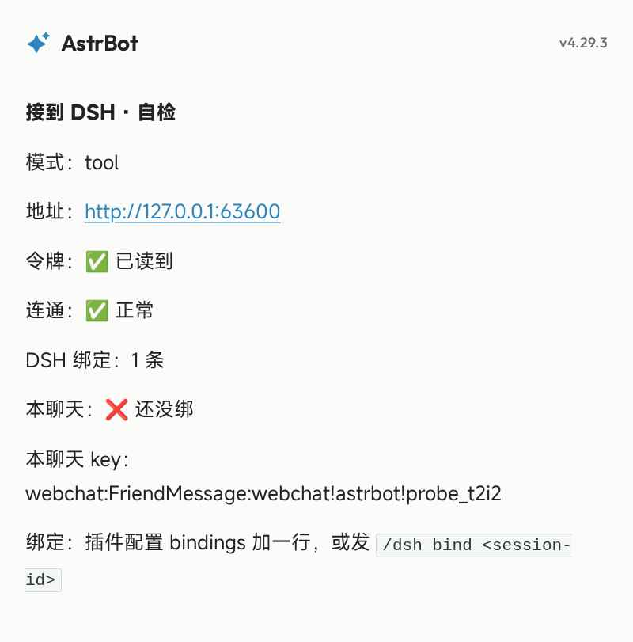

# astrbot_dsh_bridge · 接到 DSH

把「需要真的动手」的活交给本机 DSH，**回话仍然由 AstrBot 自己说**。

> 人格、记忆、说话风格一点不丢：最终那句话永远是 AstrBot 写的，DSH 的输出只作为工具结果。
> 它替代不了 DSH——DSH 没装、没启动、没绑定时，这个插件会**静默放行**，AstrBot 照常聊天。

---

# 使用须知

## 一、装之前必须先有

| 前置 | 说明 |
|---|---|
| **DSH 正在运行** | 且已装并启用 `dsh-astrbot-bridge` 插件（它提供回环 HTTP 接口） |
| **token** | DSH 插件首次启动自动生成，写在 `~/.dsh/astrbot-bridge-config.json`；**本插件自动读，不用手填** |
| **绑定** | 每个 QQ 聊天要绑到一个 DSH 会话，否则请求 404，插件静默放行 |

顺序不能反：**先起 DSH → 再起 AstrBot**。反了的话首次调用读不到 token，会一直走"够不着"分支。

## 二、装完必做的三件事

1. **重启 AstrBot**（或热重载本插件）——工具是在 `__init__` 里注册的，不重载不生效。
2. **打开插件配置页，填绑定**（不用再 curl）：
   ```
   bindings 里一行一条：
   肥鱼:FriendMessage:2604290364 = session-17248a5f-…
   ```
   等号左边是 AstrBot 的会话 key，右边是 DSH 的 session id。保存即生效，插件会自动推给 DSH（`auto_bind` 开着的时候）。
   ⚠️ key 第一段是 **AstrBot 的平台 id**（`cmd_config.json` 的 `platform[].id`，本机是「肥鱼」），**不是**适配器名 `aiocqhttp`。写错不会报错——表现为"DSH 完全没反应"。
3. **发 `/dsh` 自检**，然后在聊天里问「帮我看下 D 盘还剩多少」验收。

### 聊天里的引导命令

| 命令 | 作用 |
|---|---|
| `/dsh` | 自检：模式、地址、token 有没有读到、DSH 通不通、绑定数、本聊天绑没绑、**DSH 侧累计 token 用量**。**以图片卡片发出** |
| `/dsh help` | 怎么配（三步） |
| `/dsh bind <session-id>` | 把当前聊天临时绑到某个 DSH 会话（想长期保留仍需写进配置页） |



> 卡片走 AstrBot 的文转图；模板会把单个换行当空格吃掉，所以代码里每段之间刻意留了空行——改文案时别把空行去掉。

## 三、它是怎么判断要不要动手的

模型自己决定。工具描述里写死了边界：只做「查看/读写文件、跑命令、查系统状态、多步任务」；明确要求**不要**用它聊天、寒暄、答常识题。

所以：
- 「帮我看下 D 盘」→ 调工具 → DSH 干活 → AstrBot 用自己的话说结果
- 「在干嘛呀」→ 不调工具 → 纯人格回复

如果该调却没调，把 `dsh_run` 的 description 往"需要真实查本机数据时必须用它"的方向再拧一点。

## 四、前缀直连（可选开关）

配置里打开 `prefix_direct` 后，发 **`/dsh <要做的事>`** 就不经过模型判断，直接当命令执行、原样返回结果：

```
/dsh 看一下 D 盘还剩多少
/dsh 用 bili_status 说下现在B站什么状态
```

- 前缀可以改（`trigger_prefix`），改完那个名字也会被接管。
- 不带参数发 `/dsh` 仍然是自检卡片；`/dsh help`、`/dsh bind` 保留。
- 开关关着时，`/dsh <任务>` 只会提示你去打开它，不会偷偷执行。

### 值班关键词

`bili_run` 默认被禁用——它会在后台另起一个 headless 会话，把 `duty.md` 走完整流程（写日报、复核评论、看私信），跟"当前会话自己查一遍"是两码事，两个都跑就是双份钱。

所以只有消息里出现 `值班` / `日报`（可在配置里改 `duty_keywords`）时，插件才给这一轮带上放行标记；DSH 侧临时解除禁用，跑完立刻收回。

实测：

- 不带关键词 → `这个工具在桥接里被禁用了（bili_run）；要跑值班请说「值班」或「日报」`
- 带关键词 → `bili_run` 正常执行（它自己的冷却/额度判断照旧生效）

## 五、权限：管理员全开，其他人按白名单

AstrBot 每次调用都会告诉 DSH「这个人是不是管理员」（`event.is_admin()`，名单在 `cmd_config.json` 的 `admins_id` 里）。

| 身份 | DSH 那边 | 能用的工具 |
|---|---|---|
| 管理员 | 进「全权限会话」 | 全部（`bili_*`、`web_*`、`pwsh`、读写文件…） |
| 其他人 | 进「游客会话」 | 只有 DSH 侧 `guestAllow` 前缀匹配的（默认 `bili_*` `web_*` `todo_*` `present`） |

两条关键事实：

- **不是提示词约束，是工具级强制**。被挡掉的工具对模型**不可见**，它连名字都看不到。原理是引擎的 `ctx.tools.restrict({allow})`。
- **`restrict` 挡不住作用域内注册的工具**（比如 `subagent`），所以另外加了一道 `guard` 按名字硬拦。实测游客调 `subagent` 会收到「这个操作不在可用范围内（subagent）」。

想改白名单：DSH 侧配置文件的 `guestAllow`（前缀匹配）。想连管理员也受限：关掉插件配置里的 `admin_full_access`。

## 六、出问题时先看这三个信号

| 现象 | 多半是 | 查什么 |
|---|---|---|
| 完全没反应，像没装 | 插件没加载 | AstrBot 插件列表里有没有它；`activated` 是否 true |
| 说"看不了/没法碰电脑" | 工具没注册 | 插件是否真的 activated（import 报错会导致整块消失） |
| 说"DSH 够不着" | DSH 没起 / 端口变了 | `~/.dsh/astrbot-bridge-endpoint.json` 里的 origin 能不能打开 |

## 七、配置项（插件配置页）

| 键 | 默认 | 说明 |
|---|---|---|
| `mode` | `tool` | `tool`（模型调工具）/ `direct`（整轮转发，人格会丢）/ `both` |
| `timeout` | 90 | 秒。同步等多久；到点还没完就转后台 |
| `job_max_wait` | 600 | 秒。转后台后最多追多久，跑完补发一条消息 |
| `bindings` | 空 | 聊天 → DSH 会话，一行一条 `<key> = <session>` |
| `auto_bind` | 开 | 保存配置/插件加载时，自动把 bindings 推给 DSH |
| `admin_full_access` | 开 | 管理员是否拿到 DSH 全部工具 |
| `prefix_direct` | **关** | 打开后 `/dsh <任务>` 直接执行 |
| `trigger_prefix` | `/dsh` | 前缀直连用的前缀 |
| `dsh_url` / `token` | 空 | 留空 = 自动从 `~/.dsh` 读（推荐留空） |
| `private_always` | true | 仅 `direct` 模式用 |

## 八、已知限制

| 限制 | 现状 |
|---|---|
| 超时后结果被丢弃 | ✅ 已解决：超时转后台，跑完**补发一条消息**到原聊天（`job_max_wait` 控制追多久） |
| 图片只传文字 | ✅ 已解决：消息里的图片转 base64 一起交给 DSH（最多 4 张、单张 6MB） |
| 冷启动第一轮较慢 | ✅ 已解决：DSH 侧启动时**预热**绑定表里的每间会话（`warmup`） |
| 工作会话在侧栏看不到 | 部分解决：插件会把工作目录登记成侧栏工作区；会话是否列出取决于 UI 的分组方式，刷新侧栏确认 |

仍然存在的：

- 没有「中断某一轮」的引擎接口——超时只能转后台等它自己跑完（取消不在能力范围内）
- 只能"派任务"，不能精确"点某个工具"（这是路线 3 的设计前提）

---

## 实现说明

注册一个 `FunctionTool[AstrAgentContext]`：

```
dsh_run(task: string, cwd?: string) -> string
```

`call()` 里读 `unified_msg_origin` 作为 key，POST 到 DSH 的 `/astrbot-bridge/api/tool`，把返回的 `text` 原样交给上游模型。失败时返回一句人话，不抛异常——避免把整个回合打挂。

`mode=direct` 时另有一条整轮转发链路（`/turn`），保留给排障用。
